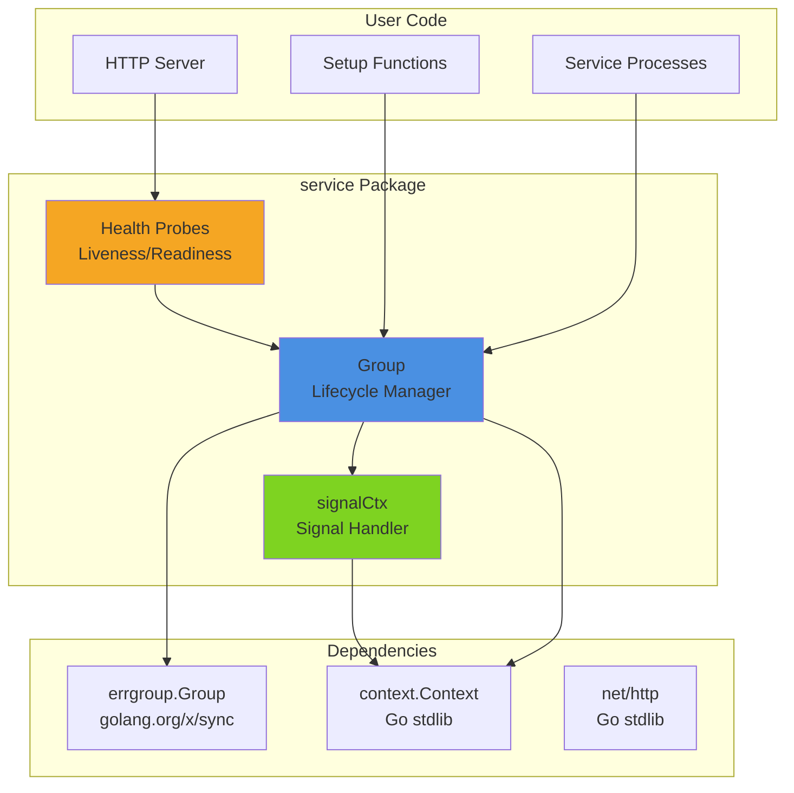
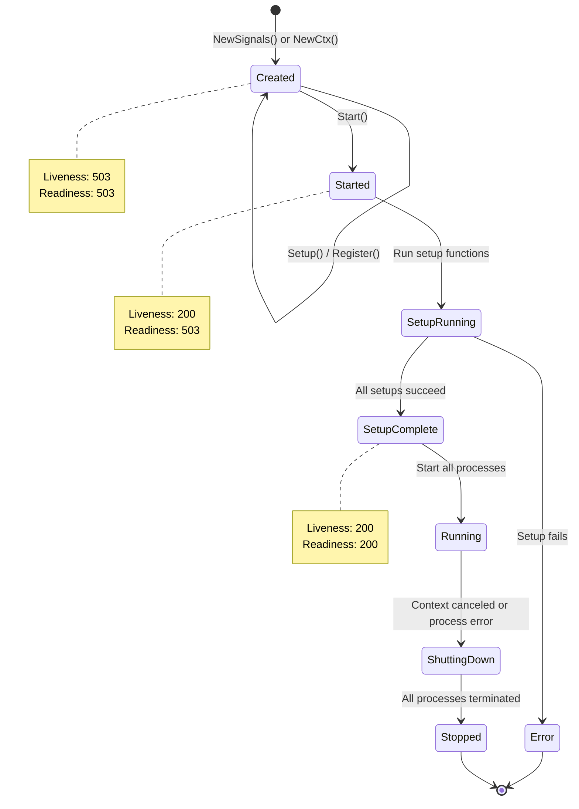
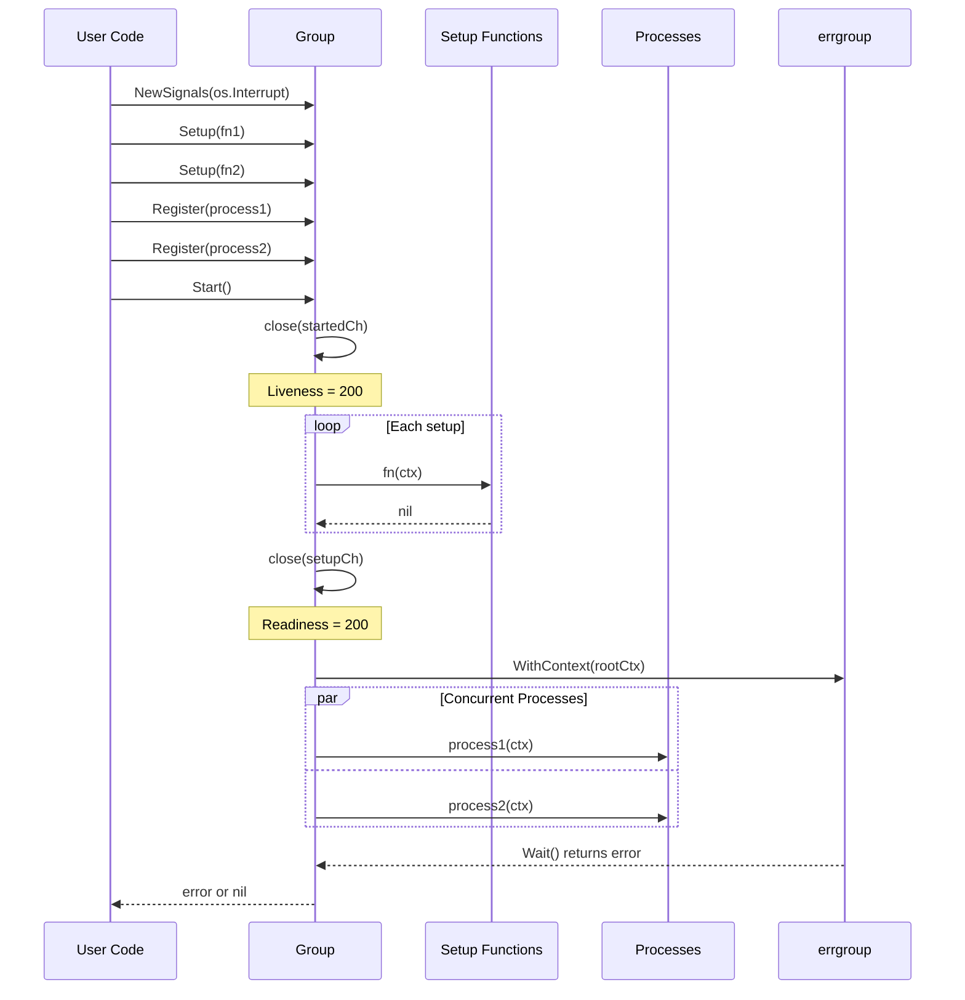
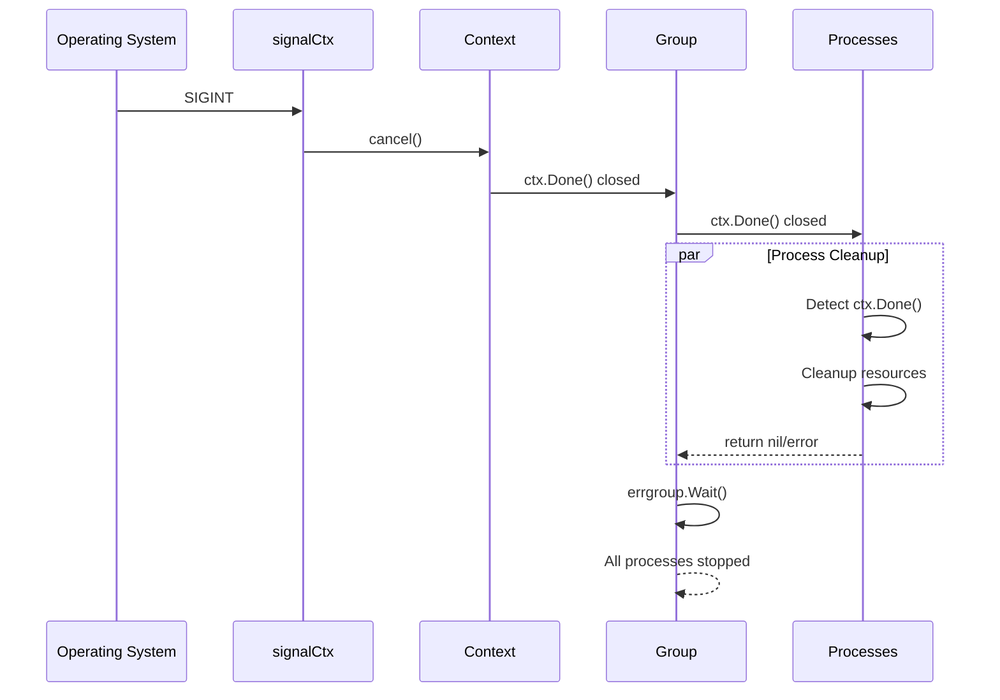
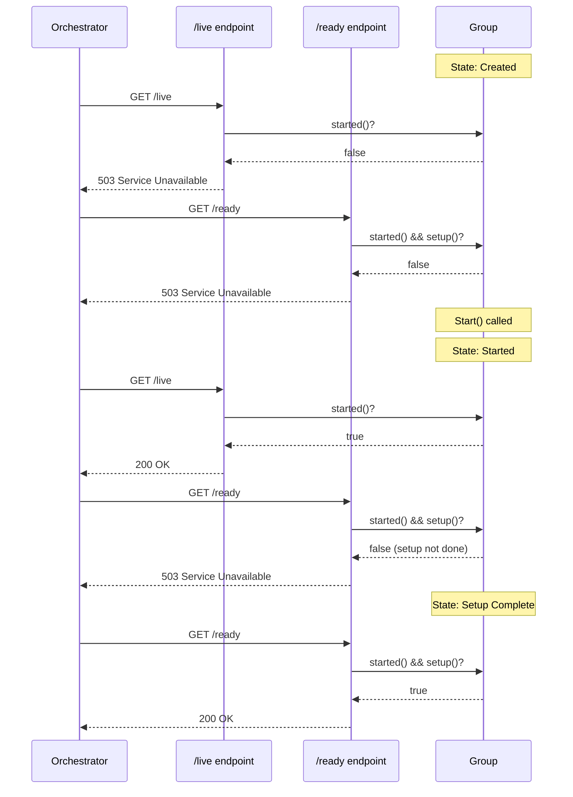

# Architecture

## Overview

The `service` package provides a lightweight orchestration layer for Go services. It manages the lifecycle of multiple concurrent components with support for graceful shutdown, setup phases, and health check probes.

## Core Concepts

### Service Group
The `Group` is the central orchestration type that:
- Manages setup and runtime phases
- Coordinates multiple concurrent processes
- Handles context cancellation and signal propagation
- Provides health check endpoints

### Lifecycle Phases

1. **Created**: Group initialized, functions registered
2. **Started**: `Start()` called, setup functions begin
3. **Setup Complete**: All setup functions finished successfully
4. **Running**: All registered processes running concurrently
5. **Shutting Down**: Context canceled (signal or error)
6. **Stopped**: All processes terminated

## Component Diagram



## Data Flow

### Group Structure

```mermaid
classDiagram
    class Group {
        -context.Context rootCtx
        -func() rootCancel
        -chan struct{} startedCh
        -chan struct{} setupCh
        -[]runFn setups
        -[]runFn processes
        +Setup(fn)
        +Register(fn)
        +Start() error
        +Close() error
        +Liveness() HandlerFunc
        +Readiness() HandlerFunc
        -started() bool
        -setup() bool
    }

    class runFn {
        <<function>>
        +func(context.Context) error
    }

    Group --> runFn : contains
```

### State Machine



## Sequence Diagrams

### Service Startup



### Signal Handling



### Health Check Probes



## Key Design Decisions

### 1. Errgroup for Process Management
**Decision**: Use `golang.org/x/sync/errgroup` for concurrent process execution.

**Rationale**:
- Automatic context propagation on first error
- Simplified error collection from multiple goroutines
- Well-tested, official Go extension library

### 2. Two-Phase Initialization
**Decision**: Separate setup phase from process execution phase.

**Rationale**:
- Allows initialization work before service starts accepting traffic
- Setup functions run sequentially, reducing race conditions
- Processes run concurrently only after setup succeeds
- Enables accurate readiness probes

### 3. Channel-Based State Tracking
**Decision**: Use closed channels for state signaling (`startedCh`, `setupCh`).

**Rationale**:
- Non-blocking state checks via `select`
- Multiple readers can check state simultaneously
- Channel closure is a one-time, thread-safe signal
- No need for mutexes

### 4. No Restart Logic
**Decision**: Group stops permanently if any process errors or context cancels.

**Rationale**:
- Simplicity: restart logic belongs at orchestration layer (systemd, k8s)
- Predictability: clear failure semantics
- Safety: prevents cascading failures or partial states

### 5. Context-First Design
**Decision**: All functions accept `context.Context` as first parameter.

**Rationale**:
- Standard Go idiom
- Enables cancellation, deadlines, and value propagation
- Works naturally with errgroup
- Testable with custom contexts

## Error Handling Strategy

### Setup Phase
- Errors stop execution immediately
- No processes start if setup fails
- Error returned directly to caller

### Process Phase
- First error cancels context for all processes
- errgroup waits for all goroutines to complete
- First error is returned (others are discarded)

### Signal Handling
- Signal causes context cancellation
- Processes should return nil on graceful shutdown
- User code determines error handling for abrupt termination

## Testing Architecture

### Unit Tests
- Test each component in isolation
- Mock contexts and channels for state verification
- Test concurrency with goroutines and channels

### System Tests
- Build real binary (`examples/server`)
- Test actual signal handling (SIGINT)
- Verify HTTP probe endpoints work correctly
- Integration test of full lifecycle

## Performance Considerations

### Goroutine Usage
- One goroutine per registered process
- One goroutine for signal handling (if using NewSignals)
- No unbounded goroutine creation

### Memory
- Fixed allocations after Start()
- Channel cleanup via garbage collection after closure
- No internal buffering or queuing

### Latency
- Health probes: O(1) channel select
- Start(): Sequential setup then concurrent processes
- Shutdown: Bounded by slowest process cleanup

## Extension Points

### Custom Context Creation
```go
ctx := context.WithTimeout(context.Background(), 30*time.Second)
g := service.NewCtx(ctx)
```

### Custom Signal Handling
```go
g := service.NewSignals(os.Interrupt, syscall.SIGTERM, syscall.SIGHUP)
```

### Wrapping Existing Servers
```go
g.Register(func(ctx context.Context) error {
    srv := &http.Server{Addr: ":8080"}
    go func() {
        <-ctx.Done()
        srv.Close()
    }()
    return srv.ListenAndServe()
})
```

## Limitations

- No built-in retry logic
- No process dependencies (all start concurrently)
- No partial failure handling (one fails, all stop)
- No built-in metrics or logging
- No configuration management

These are intentional design choices to keep the library focused and composable.
